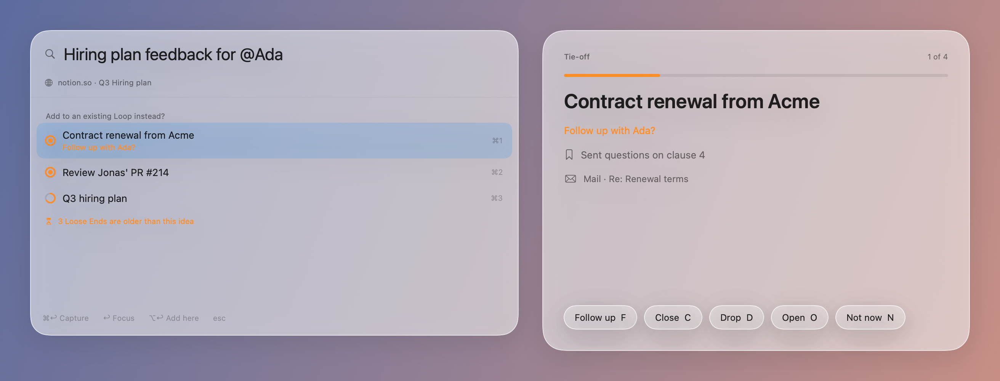
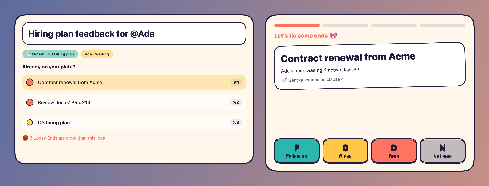
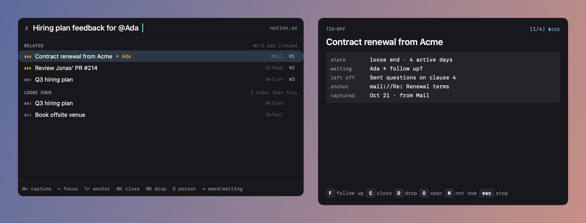

# Visual directions (ticket #17)

Throwaway prototypes of the panel and the Tie-off in three directions. Not part of the app, and this branch is never merged.

```bash
cd Prototypes/VisualDirections
SDKROOT=$(xcode-select -p)/SDKs/MacOSX26.sdk swift run
```

A window opens with a switch between the three directions. `swift run VisualDirections --render <dir>` writes the screenshots below. Liquid Glass can't be rendered offscreen, so direction A's screenshot uses a frosted stand-in; run the gallery to see the real glass.

| | Feel | Panel | Tie-off | Motion and sound |
|---|---|---|---|---|
| **A · Calm Glass** | Native macOS 26, quiet, spacious | Liquid Glass sheet, thin aging rings, hints in tertiary text | Big title, glass capsule buttons with key letters | Soft fades and slides, system "Glass" sound on finish |
| **B · Playful** | Warm, rounded, a bit cheeky | Cream card with ink outlines, colored chips, aging blobs that grow and warm up | Tilted card, chunky colored keys with a drop shadow, friendly copy ("Ada's been waiting 4 active days 👀") | Springy cards, bouncing keys, a custom pop and a little fanfare on finish |
| **C · Dense, keyboard-first** | Dark, compact, Raycast-like | Sections (Related, Loose Ends), Source per row, every key listed in the footer | Key/value grid, keycaps for every action | Almost none; instant transitions, a short click |





## App icon and logo prompts for Nano Banana 2

Shared brief for all prompts: *unfocused is a Mac menu bar app that keeps track of the work you've started across apps ("Loops") and helps you finish it. The symbol is a ring that isn't quite closed: an open loop.*

1. **Calm, native (matches A)**
   > A macOS 26 app icon in Apple's Liquid Glass style: a rounded-square squircle with a soft frosted-glass surface over a gentle blue-to-peach gradient. In the center, a thick translucent ring that is almost closed, with a small gap at the top right; one end of the ring glows faintly orange. Subtle depth, specular highlight along the top edge, no text, centered, 1024×1024, transparent background outside the squircle.

2. **Playful (matches B)**
   > A playful macOS app icon: a cream-colored squircle with a bold dark navy outline. Inside, a chunky hand-drawn loop of coral yarn that doesn't quite close, its loose end curling out to the right with a small knot. Flat colors with a hard offset shadow, friendly and slightly imperfect, no text, 1024×1024.

3. **Dense, focused (matches C)**
   > A minimal dark macOS app icon: a near-black squircle with a fine inner border. In the center, a thin light-blue circular arc covering about 300 degrees, ending in a small amber dot where the gap starts, like a progress ring about to close. Crisp vector look, very subtle grain, no text, 1024×1024.

4. **Wordmark**
   > A lowercase wordmark "unfocused" in a clean geometric sans-serif, where the letter "o" is replaced by an open ring with a small gap at the top right. Dark text on white, generous letter spacing, vector-style, centered, wide aspect ratio.

## What's needed from you

Pick a direction (or a mix, for example "A's calm with C's key hints"). The choice gets recorded in #17 and #19 applies it to the app.
